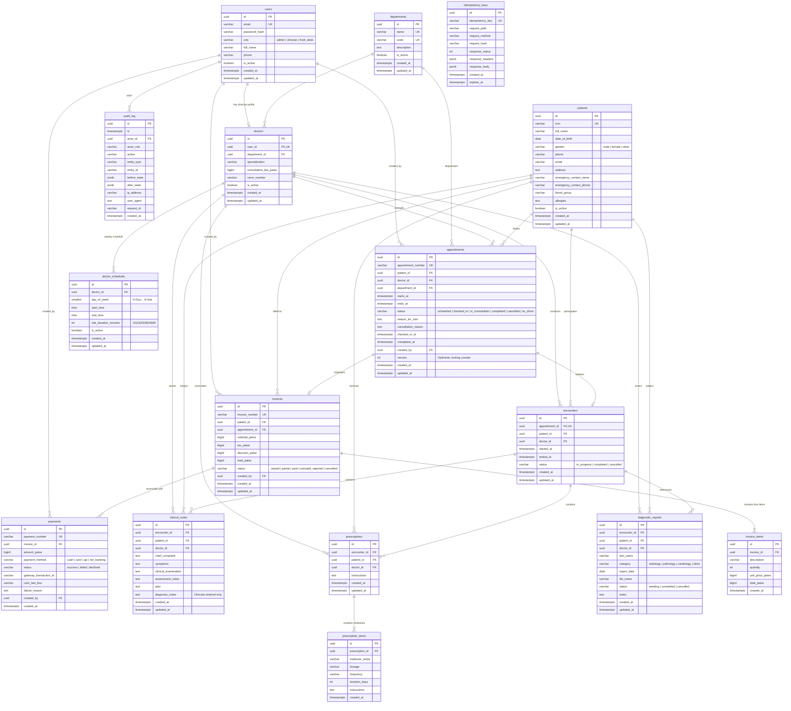

# Aarogya HMS — Entity Relationship Diagram

This document describes the relational database schema implemented in PostgreSQL 16.

## Schema Overview

All primary keys use UUID v4. Monetary amounts are strictly stored as `BIGINT` representing integer paise (1 INR = 100 paise) to prevent floating-point calculation inaccuracies.



## Key Database Constraints & Features

1. **Doctor Double-Booking Exclusion Constraint**:
   ```sql
   CONSTRAINT uq_doctor_slot_no_overlap EXCLUDE USING gist (
       doctor_id WITH =,
       tstzrange(starts_at, ends_at) WITH &&
   ) WHERE (status IN ('scheduled', 'checked_in', 'in_consultation', 'completed'))
   ```
   Enforced at the storage engine level with `btree_gist`. Any race condition or overlapping insert/update raises SQLSTATE `23P01` and is converted to HTTP 409 `SLOT_TAKEN`.

2. **Patient Double-Booking Exclusion Constraint (Migration 002)**:
   ```sql
   CONSTRAINT uq_patient_slot_no_overlap EXCLUDE USING gist (
       patient_id WITH =,
       tstzrange(starts_at, ends_at) WITH &&
   ) WHERE (status IN ('scheduled', 'checked_in', 'in_consultation', 'completed'))
   ```
   Enforced at the storage engine level. Prevents a single patient from holding overlapping appointments with multiple doctors simultaneously. Violation raises SQLSTATE `23P01` and is mapped to HTTP 409 `PATIENT_DOUBLE_BOOKED`.

2. **Immutable Audit Log**:
   ```sql
   CREATE TRIGGER trg_audit_log_append_only
   BEFORE UPDATE OR DELETE ON audit_log
   FOR EACH ROW
   EXECUTE FUNCTION prevent_audit_log_modification();
   ```
   Guarantees non-repudiation and tampering resistance. Any SQL `UPDATE` or `DELETE` attempt throws SQLSTATE `55000`.

3. **Strict Monetary Accounting**:
   All money stored in integer paise. Negative balances and discounts are strictly forbidden via DB check constraints:
   ```sql
   CONSTRAINT chk_invoice_math CHECK (total_paise = subtotal_paise + tax_paise - discount_paise)
   CONSTRAINT chk_item_total CHECK (total_paise = quantity * unit_price_paise)
   ```
